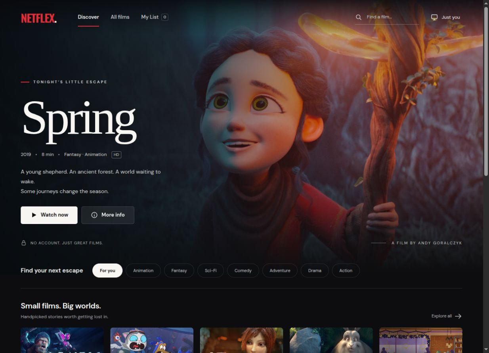

# NetFlex — web cinema

A Netflix-inspired web app with real playback of openly licensed Blender films. No sign-in, uploads, or visitor tracking.

**[Watch NetFlex online](https://netflex.joyson01.me)** · **[Web app source and setup](web/README.md)**



## Web app

- Ten openly licensed films with creator credits and licence links.
- Search, genre filters, film details, and mobile-friendly browsing.
- My List and Continue Watching saved in the visitor's browser.
- Fullscreen playback, quality selection, seeking, and resume controls.
- No backend, database, account, or API key required.

### Run locally

From the repository root:

```sh
python3 -m http.server 4187 --bind 127.0.0.1 --directory web/dist
```

Open http://127.0.0.1:4187. Use HTTP rather than opening the HTML file directly.

### Verify

Requires Node.js 18 or newer:

```sh
node --check web/dist/app.mjs
node --test web/tests/*.test.mjs
```

Films stream from Blender's servers. Availability depends on the source provider and your connection. Browser storage is specific to each device and site address; clearing it removes saved lists and progress. The app is independent of Netflix and Blender.

## Original desktop project

The original Python/Tkinter/VLC application and its assets remain in `main.py`, `Images/`, and `Audio/`. Its original documentation follows.

---

# Netflicks - Video Player   

## Description
This application is a custom video player integrated with Netflix-like profiles and menu navigation, built using Python and Tkinter.

## Features
- Fullscreen video playback with VLC media player integration.
- Profile selection with direct links to Netflix profiles.
- Interactive menu sidebar with navigation options.
- Thumbnail-based video selection with a scrollbar.

## Controls
- **Pause/Play**: Spacebar
- **10 Seconds Forward**: Right Arrow Key
- **10 Seconds Rewind**: Left Arrow Key
- **Exit Player**: Esc Key

## Installation
1. **Python 3**: Install Python 3.12.4 from [Python.org](https://www.python.org/ftp/python/3.12.4/python-3.12.4-amd64.exe)
2. **VLC**: Install VLC 3.0.21 from [VLC website](https://mirror.kku.ac.th/videolan/vlc/3.0.21/win64/vlc-3.0.21-win64.exe)
3. Install required Python libraries:
   ```
   pip install pillow python-vlc
   ```

## Libraries Used
- Tkinter
- Webbrowser
- Datetime (timedelta)
- Vlc
- PIL (Image, ImageTk)

## Authors
- **Joyson Vadlya**
- **Shrisankhya Purandare**

## © 2024 (J.A.VA) Joyson Vadlya . All rights reserved.
---
